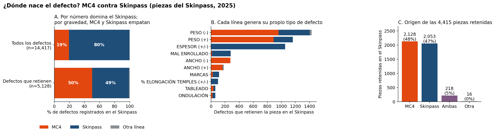

# Propuesta: ¿dónde nace el defecto, en el MC4 o en el Skinpass?

Abre [`propuesta.html`](propuesta.html) en el navegador para ver la propuesta completa (descárgala o clona el repo; GitHub no renderiza HTML). El análisis está en [`notebooks/antecedentes/investigacion.ipynb`](../notebooks/antecedentes/investigacion.ipynb).

El catálogo de columnas con dato está en [`variables.html`](variables.html): qué variables de los Excel de MC4 y Skinpass se pueden usar, y cuáles vienen vacías.

## Hallazgo
Usamos la columna `Linea Origen` de cada defecto del Skinpass (14,417 defectos en 58,786 piezas de 2025) y ligamos el 97.1% de las piezas con su rollo del MC4.

- Por número, el 80% de los defectos se generan en el Skinpass y el 19% vienen del MC4.
- Por gravedad empatan: de los defectos que **retienen** la pieza, 50% son de origen MC4 y 49% del Skinpass. El 92% de los defectos del MC4 retienen la pieza, contra el 22% de los del Skinpass.
- Todas son piezas retenidas **en el Skinpass**: el 50/50 es de dónde viene su defecto.

## Toneladas retenidas en el Skinpass (2025)
| | Piezas | Toneladas |
|---|---|---|
| Retenidas en el Skinpass | 4,415 | 82,510 (7.2% del tonelaje) |
| Origen MC4 | 2,346 | 44,261 |
| · peso fuera de la orden | 1,846 | 34,235 |
| · ancho fuera de tolerancia | 446 | 8,152 |
| Origen Skinpass | 2,271 | 40,592 |

Una pieza puede tener defectos de ambos orígenes, por eso las filas no suman exacto.

- **Ancho (8,152 t):** defecto físico. El MC4 ya lo había marcado en el 92% de los casos y aun así el rollo siguió al Skinpass, que no puede corregirlo.
- **Peso (34,235 t):** problema de asignación de órdenes. Entre el 70 y el 80% de esos rollos cumplían su tolerancia en el MC4, pero no la ventana de peso de la orden del Skinpass. En PESO (-), el 55% de las piezas salieron de un rollo dividido.

## Pregunta detonadora
**Principal (peso, 34,235 t):** ¿cuánto bajaría la retención por peso en el Skinpass si, antes de asignar o dividir un rollo del MC4, se verificara que su peso real cabe en la ventana de peso de la orden del Skinpass?

**Secundaria (ancho, 8,152 t):** ¿si en el MC4 se ajusta el canteo del desbaste (R1 y R2) según el producto para centrar el ancho, baja la retención por ancho en el Skinpass sin aumentar otros defectos?

**Alternativa (óxido rojo dentro del MC4):** ¿más reducción en los castillos de adelante y menos en los de atrás reduce el óxido rojo? (Han et al., 2019).

## Por qué le importa a Ternium
- Menos toneladas detenidas (reinspección, almacenaje, reasignación, entregas tarde, venta como material de menor calidad).
- La propuesta principal no requiere inversión en equipo: es una regla de planeación.
- Evita procesar en el Skinpass material que ya venía fuera de tolerancia.
- Responde su pregunta original: la mitad de lo retenido viene antes del Skinpass.
- Para traducirlo a dinero falta el costo por tonelada retenida: `ahorro ≈ toneladas evitadas × costo por tonelada retenida`.

## Límites
- `Linea Origen` es la atribución que registra la planta, no una prueba causal.
- Peso, ancho y espesor son reglas automáticas contra una tolerancia (ver `02_calidad`).
- No tenemos costos; todo está en toneladas y piezas.

La tabla de literatura y las referencias completas están en `propuesta.html`.
